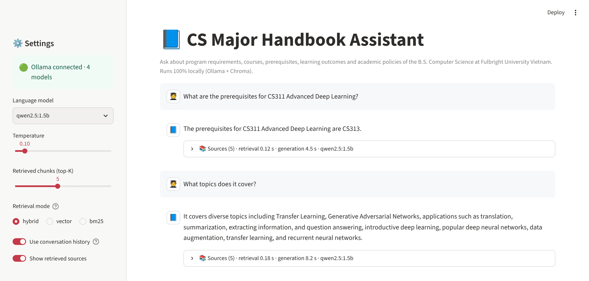
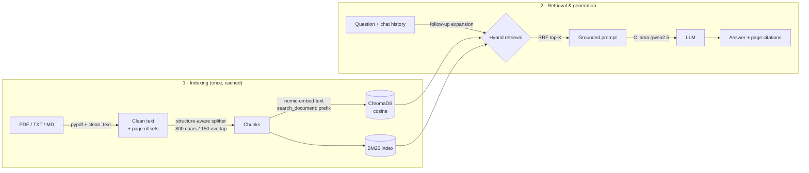

# 📘 CS Handbook RAG — a fully local Retrieval-Augmented Generation chatbot

> CS311 Advanced Deep Learning · Final project · Fall 2026
> Dinh Hong Ngoc · Fulbright University Vietnam

A question-answering assistant for the **B.S. Computer Science Major Handbook** that runs
**100 % on your own machine**: documents never leave the computer, there are no API costs and it
works offline. It is built on Ollama (local LLMs + embeddings), ChromaDB and Streamlit, and
extends the course's baseline `run_txt.py` with PDF support, better retrieval, a grounded prompt,
a web UI, Docker deployment and a reproducible evaluation.

<p align="center"></p>

---

## ✨ Features

| | Feature | Where |
|---|---|---|
| Task 1 | **PDF support** – pypdf text extraction, ligature/TOC cleaning, page-number tracking, scanned-PDF warning; `.txt`/`.md` still supported | `rag/loaders.py` |
| Task 2 | **Handbook chatbot** – structure-aware chunking, nomic task prefixes, cosine distance, **hybrid retrieval** (vector + BM25, Reciprocal Rank Fusion), grounded prompt with “not found” rule, follow-up question handling, page citations | `rag/engine.py`, `run_rag.py` |
| Task 2 | **Evaluation** – 32 test questions, retrieval ablation (Hit@k, MRR), 5 system/LLM configurations | `evaluate.py`, `eval/` |
| Task 3 | **Docker** – app image + `docker compose` stack (Ollama, model download, app) with volumes | `docker/` |
| Task 4 | **Web UI** – Streamlit chat with history, streaming answers, sources with pages & scores, model switcher, export | `app.py` |
| extra | Automatic re-indexing when documents change (SHA-1 manifest), max-token guard against repetition loops | `rag/engine.py` |

## 🧭 Architecture



## 📁 Repository layout

```
ADL-<StudentID>-project/
├── README.md                     ← you are here
├── source_code/
│   ├── config.py                 ← all settings (overridable with env variables)
│   ├── rag/
│   │   ├── loaders.py            ← Task 1: PDF/TXT/MD loading + cleaning
│   │   ├── engine.py             ← indexing, hybrid retrieval, prompting, generation
│   │   └── bm25.py               ← dependency-free BM25 keyword index
│   ├── run_rag.py                ← CLI (single question or --chat)
│   ├── app.py                    ← Task 4: Streamlit web UI
│   ├── evaluate.py               ← Task 2: retrieval ablation + answer evaluation
│   ├── eval/questions.json       ← 32 test questions with reference answers
│   ├── eval/results/             ← evaluation outputs (jsonl + markdown tables)
│   ├── data/handbook/            ← CS_MajorHandbook.pdf (knowledge base)
│   ├── data/pdf_demo/            ← another PDF for the Task 1 demo
│   ├── data/txt_demo/            ← the original sample .txt files
│   ├── run_txt_baseline.py       ← the unmodified sample code (for comparison)
│   ├── screenshots/
│   └── requirements.txt
├── docker/
│   ├── Dockerfile                ← app image
│   ├── Dockerfile.dockerignore
│   ├── entrypoint.sh             ← waits for Ollama; web | cli | eval modes
│   ├── docker-compose.yml        ← full stack: ollama + model-init + app
│   └── docker-compose.host-ollama.yml ← app only, uses Ollama running on the host
├── report/report.pdf
└── demo_video/                   ← videos or links + VIDEO_SCRIPTS.md
```

## 🚀 Quick start (local, without Docker)

**1. Install Ollama and pull the models** (<https://ollama.com/download>)

```bash
ollama serve                       # keep running in a separate terminal
ollama pull nomic-embed-text       # embeddings (274 MB)
ollama pull qwen2.5:1.5b           # default LLM (986 MB)
ollama pull qwen2.5:0.5b           # optional, fastest
ollama pull qwen2.5:3b             # optional, most accurate (1.9 GB)
```

**2. Create the Python environment**

```bash
conda create -n rag python=3.10 -y && conda activate rag
cd source_code
pip install -r requirements.txt
```

**3. Ask questions (CLI)**

```bash
python run_rag.py                                            # default question
python run_rag.py -q "What GPA is required for the Capstone?"
python run_rag.py --chat                                     # multi-turn chat with history
python run_rag.py --model qwen2.5:3b --show-context -q "List the sample advanced courses"
```

The first run indexes the PDF (≈20 s on a laptop CPU); later runs load the saved index from
`vector_store/`. The index is rebuilt automatically if a file in the data folder changes
(or use `--rebuild`).

**4. Web interface**

```bash
streamlit run app.py               # → http://localhost:8501
```

### Task 1 – index any PDF

```bash
python run_rag.py --data-dir data/pdf_demo --domain "the CS311 final project description" \
                  -q "How much is the Docker container deployment task worth?"
```

Any folder containing `.pdf`, `.txt` or `.md` files works. Text inside images (scanned pages)
is not extracted – that would need an OCR step.

## 🐳 Docker deployment (Task 3)

**Option A – everything in containers** (Ollama + model download + app):

```bash
cd docker
docker compose up --build -d       # first start downloads ~1.3 GB of models
docker compose ps                  # ollama: healthy · model-init: exited (0) · app: healthy
open http://localhost:8501
```

| Service | Image | Role |
|---|---|---|
| `ollama` | `ollama/ollama` | LLM + embedding server, models in volume `ollama_models` |
| `model-init` | `ollama/ollama` | one-shot `ollama pull` of the embedding model and the LLM, then exits |
| `app` | built from `docker/Dockerfile` | Streamlit UI on port 8501; handbook folder bind-mounted read-only, Chroma index in volume `vector_store` |

Useful commands:

```bash
docker compose logs -f app                                      # watch indexing / requests
docker compose exec app python run_rag.py -q "How many credits does the minor require?"
LLM_MODEL=qwen2.5:3b docker compose up -d                       # switch model
docker compose down          # stop (keeps models + index)
docker compose down -v       # stop and delete volumes
```

**Option B – use the Ollama already installed on the host** (recommended on macOS, where
Ollama inside Docker cannot use the Apple GPU):

```bash
ollama serve                                   # on the host
cd docker && docker compose -f docker-compose.host-ollama.yml up --build
```

**Option C – plain `docker run`:**

```bash
docker build -f docker/Dockerfile -t cs-handbook-rag .          # from the project root
docker run -p 8501:8501 -e OLLAMA_URL=http://host.docker.internal:11434 \
           --add-host host.docker.internal:host-gateway cs-handbook-rag
docker run --rm -e OLLAMA_URL=http://host.docker.internal:11434 \
           --add-host host.docker.internal:host-gateway cs-handbook-rag cli -q "Who can take CS401?"
```

To use another handbook, mount a different folder at `/app/data/handbook`.

## ⚙️ Configuration

All settings live in `source_code/config.py` and can be overridden by environment variables:

| Variable | Default | Meaning |
|---|---|---|
| `DATA_DIR` | `data/handbook` | folder with the documents |
| `LLM_MODEL` | `qwen2.5:1.5b` | Ollama model used for answers |
| `EMBED_MODEL` | `nomic-embed-text` | Ollama embedding model |
| `OLLAMA_URL` | `http://127.0.0.1:11434` | Ollama server |
| `CHUNK_SIZE` / `CHUNK_OVERLAP` | `800` / `150` | characters |
| `TOP_K` | `5` | chunks given to the LLM |
| `RETRIEVAL_MODE` | `hybrid` | `hybrid`, `vector` or `bm25` |
| `SCORE_THRESHOLD` | `0.60` | below this best cosine similarity → “not found” |
| `TEMPERATURE` | `0.1` | sampling temperature |
| `MAX_TOKENS` | `512` | cap on generated tokens |
| `HISTORY_TURNS` | `2` | previous Q/A pairs used for follow-ups |

## 📊 Evaluation (Task 2)

```bash
python evaluate.py --retrieval                       # retrieval ablation, ~1 min
python evaluate.py --generate improved-1.5b          # end-to-end answers for one config
python evaluate.py --generate baseline improved-0.5b improved-1.5b improved-3b baseline-1.5b
python evaluate.py --rescore                         # recompute labels / tables
```

**Retrieval** (30 answerable questions, top-5; *Evidence@5* = the exact evidence sentence is in a retrieved chunk):

| Configuration | Evidence@5 | Page-Hit@5 |
|---|---|---|
| Baseline (sample-code settings) | 0.87 | 0.93 |
| + structure-aware chunking, follow-up expansion | 0.90 | 1.00 |
| + hybrid BM25 + vector (chunk 1000) | 0.97 | 0.97 |
| **Final: hybrid, chunk 800/150** | **1.00** | **1.00** |

**End-to-end answers** (32 questions, every answer reviewed by hand):

| Configuration | LLM | Correct | Incorrect | Out-of-scope declined | s / answer (2-vCPU, no GPU) |
|---|---|---|---|---|---|
| Sample code | qwen2.5:0.5b | 12 | 18 | 0/2 | 10.7 |
| Sample code | qwen2.5:1.5b | 26 | 5 | 2/2 | 12.0 |
| This system | qwen2.5:0.5b | 17 | 9 | 2/2 | 9.6 |
| **This system** | **qwen2.5:1.5b** | **28** | **1** | **2/2** | **11.2** |
| This system | qwen2.5:3b | 25 | 2 | 2/2 | 24.2 |

Full per-question answers: `source_code/eval/results/answers_*.jsonl`; tables:
`summary.md`, `retrieval_ablation.md`. Discussion of correct / incomplete / incorrect /
ambiguous cases is in the report.

## ⚠️ Known limitations

- Text inside images is not indexed (no OCR); tables lose their column structure after PDF extraction,
  so table questions (e.g. the sample 4-year plan) are the hardest.
- Small models (0.5b) sometimes ignore instructions, answer a different question or loop; the
  default is 1.5b, and 3b is noticeably better but ~2× slower on CPU.
- The automatic correctness labels are keyword-based and were checked by hand; they are a guide, not ground truth.
- The handbook itself contains inconsistencies (e.g. “Bachelor of Science in **Applied Mathematics**” in the CS degree
  requirements, CS204 described but missing from the catalogue table) that the chatbot faithfully reproduces.
- The “not found” threshold is calibrated on this handbook only.

## 🙏 Acknowledgements

Baseline code and project description by Dr. Dang Huynh (CS311). Built with
[Ollama](https://ollama.com), [LangChain](https://python.langchain.com), [ChromaDB](https://www.trychroma.com),
[pypdf](https://pypdf.readthedocs.io) and [Streamlit](https://streamlit.io).
